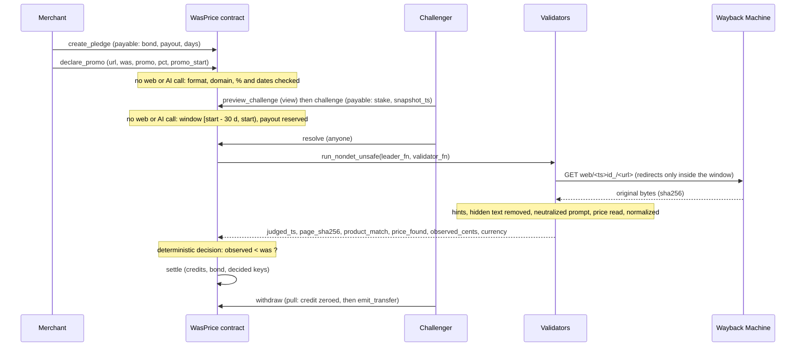

# Architecture

## Flow

The boundary:

- **Web app and script**: previews before signing, window computation, Wayback link parsing,
  display. Nothing they compute is authoritative.
- **Contract**: the bond, the window, the comparison, the payouts, and the one step that needs
  consensus: reading the price of the declared product on an archived page.
- **Wayback Machine**: the raw evidence. Validators re-fetch it and compare its hash.

## Why `id_` bytes and not a screenshot

`https://web.archive.org/web/<ts>id_/<url>` returns the page as it was archived, without the
Wayback toolbar or URL rewriting. Every validator receives the same bytes, so:

- the SHA-256 of those bytes can be compared between validators and stored on-chain;
- anyone can recompute it later with `curl.exe` and `Get-FileHash` (see the README);
- the reading is done on text (plus one image when the price is in an image), which is
  cheaper and steadier than rendering a screenshot that may differ by browser, fonts or timing.

Hidden elements are removed from that text before the model sees it, so the reading follows
what a customer saw, not what a merchant hid for machines.

## Storage

`Pledge`, `Promo` and `Challenge` dataclasses in `TreeMap[u256, ...]`, plus
`decided: TreeMap[str, bool]` (`promo:ts:kind:image_url` already judged, for both the filed and
the judged timestamp), `open_by_challenger`, `credits` and `total_credits`. `bond` is the
available part of the pledge; `reserved` holds one payout per OPEN challenge. No page or image
is stored: only URLs, timestamps and hashes.

## Size

`contracts/was_price.py` is 39,907 bytes in v1.1.0 (39,713 in v1.0.0; target < 40,000, a
margin target, not a documented limit). To get there without behavior changes the file uses tab indentation (as the GenLayer
SDK sources do) and non-essential comments were removed (cut 1 of the size plan). Cuts 2 to 4
(`promo_window` moved to the client, hints reduced to JSON-LD, image path removed) were not
needed.

## Verified platform facts

Read on docs.genlayer.com on 2026-11-13, and exercised by the direct tests (genlayer-test 0.29.2):

- Equivalence Principle, custom validator with `gl.vm.run_nondet_unsafe(leader_fn, validator_fn)`;
  the validator receives `gl.vm.Return` or an error result:
  <https://docs.genlayer.com/developers/intelligent-contracts/equivalence-principle>
- Value transfers: `@gl.public.write.payable`, `gl.message.value`, a `@gl.evm.contract_interface`
  recipient and `emit_transfer(value=u256(...))`:
  <https://docs.genlayer.com/developers/intelligent-contracts/features/value-transfers>
- Calling LLMs: `gl.nondet.exec_prompt(prompt, images=[...], response_format="json")` (the
  `images` keyword is also in the SDK source bundled with the pinned runner):
  <https://docs.genlayer.com/developers/intelligent-contracts/features/calling-llms>
- Images in prompts: <https://docs.genlayer.com/developers/intelligent-contracts/features/image-processing>
- Web access: `gl.nondet.web.get(url)` returns `status`, `headers` (bytes values) and `body`:
  <https://docs.genlayer.com/developers/intelligent-contracts/features/web-access>
- Time: `datetime.now(timezone.utc)` is the transaction time (it follows `warp` in tests).
- `hashlib.sha256` is available in GenVM (GreenClaim Bond probe, 2026-11-12).

## Studionet pitfalls

- **A refused payable call keeps its value.** Payables only check what they must, and every
  write is preceded by its `preview_*` view (or a read of the state) in the script and the web
  app; nothing is sent if the contract would refuse.
- **Studio's `read` decoder** mishandled dict returns (RLP issue seen on another project):
  every view returns JSON inside a `str`.
- **`npx genlayer call --args`** turns `0x...` into an address object and long digit strings
  (such as `20261112194333`) into integers. Never use it for `str` parameters; use
  `scripts/wasprice.ts`.
- **PowerShell**: an unquoted `39,90` is an array (`39 90`). The script accepts `39.90` only and
  says why. Empty `""` arguments are dropped: the script never needs one.
- **Receipts**: success is ACCEPTED or FINALIZED, MAJORITY_AGREE and SUCCESS. On a timeout the
  script prints the hash and `wait <hash>`; it never re-sends.
- **Deployment**: Studio puts the new address in `receipt.data.contract_address`
  (genlayer-js 1.1.8 leaves `txDataDecoded` empty there).

## Open points

- Verified on 2026-11-13 (demo case C): a Wayback `id_` request for a timestamp without an
  exact capture answers a 302 to the nearest capture, but `gl.nondet.web.get` on Studionet
  follows it and returns the final 200, so the contract never sees the redirect. v1.0.0
  therefore missed the window check after a redirect (docs/evidence.md). v1.1.0 reads the
  `Memento-Datetime` header of the returned capture (page and image), checks it against the
  window, stores it as `judged_ts`, and settles EVIDENCE_NOT_FOUND without an LLM call when
  it is missing or unreadable. Replayed on Studionet with the v1.1.0 contract: case C settles
  EVIDENCE_NOT_FOUND (`[EXTERNAL] capture not in window`) and case A is still upheld.
- TODO(verify): the Wayback Machine serves the same capture to 5 validators without rate
  limiting (no problem seen on GreenClaim Bond; not documented).
- TODO(verify): the delay between a Save Page Now and the capture being readable in `id_`
  (a few minutes observed on GreenClaim Bond).
- TODO(verify): "at most 2 images per prompt" is taken from the Calling LLMs page as read on
  2026-11-13; the contract sends one image.
- Hidden-element removal on the demo page D is covered by
  `tests/direct/test_was_price_judge.py::test_case_d_traps_are_hidden_or_neutralized` (closed).
